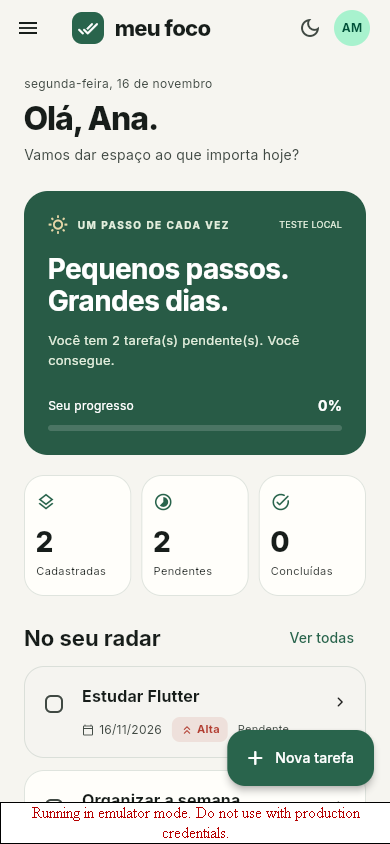
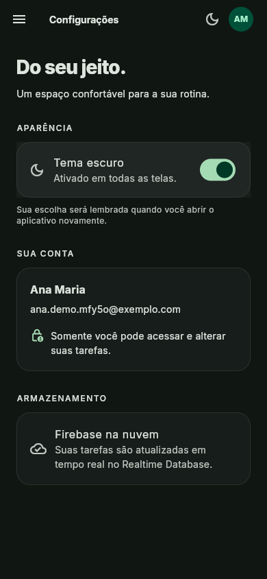

# Meu Foco

Gerenciador de tarefas pessoais em **Flutter/Dart**, desenvolvido conforme os requisitos da atividade **P2 - Desenvolvimento de Aplicativo Mobile com Flutter e Firebase**. Interface em português, com versões Android, iOS e prévia em navegador.

[Baixar APK Android](https://github.com/carlosvictor200321-alt/meu-foco-mobile/releases/latest/download/meu-foco.apk) · [Vídeo demonstrativo](docs/video/demonstracao.webm)

| Início | Tema escuro |
| --- | --- |
|  |  |

## Abrir o aplicativo

- **Android:** baixe o [APK da versão mais recente](https://github.com/carlosvictor200321-alt/meu-foco-mobile/releases/latest/download/meu-foco.apk) ou instale `entrega/meu-foco.apk` após gerá-lo localmente. Essa versão já está conectada ao Firebase na nuvem e usa a internet. A versão `meu-foco-local.apk` exige os emuladores no computador e o redirecionamento USB descrito abaixo.
- **Navegador:** dê dois cliques em **Abrir aplicativo.bat**.
- **Teste local:** abra **Abrir emuladores.bat** e, em seguida, **Abrir aplicativo local.bat**.

Crie sua conta com nome, e-mail e senha. Cada conta tem suas próprias tarefas. A senha é gerenciada pelo Firebase Authentication.

## Funcionalidades exigidas

| Requisito | Onde conferir |
| --- | --- |
| RF01 | Cadastro, login, logout, validações e sessão persistente com Firebase Authentication |
| RF02 | Início com nome, total de tarefas, pendentes, concluídas e progresso |
| RF03 | Drawer com Início, Minhas tarefas, Configurações, Sobre o aplicativo e Sair; nome e e-mail |
| RF04 | Título, descrição, vencimento, prioridade Baixa/Média/Alta e situação |
| RF05 | ListView, detalhes, data, situação e prioridade por cor e ícone |
| RF06 | Cadastro, consulta, edição, exclusão com confirmação e mudança de situação |
| RF07 | Firebase Realtime Database, listener onValue e regras de acesso por UID |
| RF08 | Preferência de tema salva e restaurada com SharedPreferences |
| RF09 | ThemeData, ThemeMode, lightTheme e darkTheme em todas as telas |

Inclui também busca de tarefas, filtros por situação/prioridade, recuperação de senha e confirmação ao descartar um formulário alterado.

## Ambiente

Ferramentas usadas na preparação: Flutter **3.50.0**, Dart **3.14.0**, Java **21** e Android SDK **36**. Android mínimo **7.0 / API 24**; iOS mínimo **15.0**.

Neste computador, as ferramentas foram instaladas em `C:\Users\carlo\develop` e o Flutter foi adicionado ao PATH do usuário. Os scripts também encontram essa instalação em novos terminais. O projeto está na pasta `aplicativo-mobile` da Área de Trabalho.

No Windows com scripts PowerShell restritos, use os arquivos `.bat` incluídos. Para chamar um script pelo terminal, use `powershell.exe -NoProfile -ExecutionPolicy Bypass -File .\scripts\NOME.ps1`. Essa opção vale somente para o processo iniciado.

Para preparar outro computador, instale Flutter, Git, Node.js e as ferramentas da plataforma. Em seguida:

```powershell
flutter pub get
npm.cmd ci --prefix tools/firebase
```

Os arquivos `pubspec.lock` e `tools/firebase/package-lock.json` fixam as dependências usadas. A fonte Inter e sua licença estão incluídas em `assets/fonts`, sem download de fonte durante o uso.

## Firebase na nuvem

Projeto conectado: **gerenciamento-de-tarefas-2f419**. Os arquivos de configuração pública já estão incluídos e o modo padrão utiliza a nuvem. O login por e-mail/senha e as regras do Realtime Database estão publicados.

Para repetir a configuração ou conectar outro projeto:

```powershell
.\scripts\configurar-firebase.ps1 -Projeto gerenciamento-de-tarefas-2f419
.\scripts\iniciar.ps1
```

A configuração exige login na conta proprietária do projeto. O script registra Android/iOS/Web, habilita e-mail/senha, configura o Realtime Database e publica as regras. As opções públicas são gravadas em `lib/firebase_options.dart`.

Consulte [a configuração completa do Firebase](docs/firebase.md). A estrutura é `usuarios/UID/tarefas/ID`; o servidor permite que somente o usuário autenticado correspondente leia ou altere esses dados.

## Executar em Android

Conecte um aparelho com depuração USB habilitada e autorize o computador no aparelho:

```powershell
flutter devices
.\scripts\iniciar.ps1 -Dispositivo ID_DO_CELULAR
.\scripts\gerar-apk.ps1
```

O último comando gera `entrega/meu-foco.apk`. A assinatura de desenvolvimento é adequada para instalar e apresentar a atividade. Publicação na Play Store exige uma chave de assinatura do proprietário.

O script de geração usa um alias temporário de unidade no Windows para que o compilador Android trabalhe com um caminho sem acentos. Os arquivos continuam na pasta original da Área de Trabalho e o alias é removido ao terminar.

Para testar com Firebase local:

```powershell
.\scripts\emuladores.ps1
# Em outro terminal, com o aparelho conectado:
& "$env:ANDROID_HOME\platform-tools\adb.exe" reverse tcp:9099 tcp:9099
& "$env:ANDROID_HOME\platform-tools\adb.exe" reverse tcp:9000 tcp:9000
.\scripts\iniciar.ps1 -Modo local -Dispositivo ID_DO_CELULAR -HostEmulador 127.0.0.1
```

O emulador Android padrão usa `10.0.2.2` automaticamente. Os dados locais são exportados ao encerrar o Firebase com Ctrl+C. O modo local é identificado dentro do aplicativo.

Para iOS, o código-fonte está em `ios/`. A compilação e a instalação em iPhone precisam de macOS, Xcode e uma configuração de assinatura Apple.

## Organização do código

```text
lib/
  main.dart                     Inicialização
  app.dart                      Sessão, rotas e aplicação do tema
  firebase_options.dart         Opções públicas das plataformas Firebase
  models/                       Usuario e Tarefa
  screens/                      Autenticação, início, tarefas, detalhes, configurações e sobre
  services/                     Auth, Realtime Database, preferências e estado da listagem
  widgets/                      Drawer, cartões, componentes e dependências
  themes/app_theme.dart         lightTheme e darkTheme
test/                           Testes de modelos, preferências e fluxos de interface
database.rules.json             Regras de acesso e validação do Realtime Database
tools/firebase/                 Ferramentas de configuração e testes de integração
docs/                           Requisitos, capturas, evidências e roteiro da demonstração
entrega/                        APKs e pacote do código-fonte
```

O campo `dataVencimento` representa `DataVencimento` do enunciado com a convenção de nomes do Dart. Todas as operações de tarefas usam o model `Tarefa`; os dados da sessão usam `Usuario`.

## Validação

```powershell
flutter analyze
flutter test --reporter expanded
# Com o emulador de banco iniciado:
node --test tools/firebase/rules.test.mjs
```

Ou execute `.\scripts\testar.ps1` com as portas dos emuladores livres. Os testes do banco confirmam CRUD, listener e bloqueio de acesso anônimo e entre contas.

Para repetir o fluxo completo e gerar capturas/vídeo:

```powershell
.\scripts\emuladores.ps1
# Em outro terminal:
flutter build web --debug --dart-define=USE_FIREBASE_EMULATOR=true
python -m http.server 5173 --bind 127.0.0.1 --directory build/web
# Em outro terminal:
tools\firebase\node_modules\.bin\playwright.cmd install chromium
node tools/firebase/ui-flow.mjs
```

Para validar a nuvem, compile a prévia sem a definição de emulador e defina `UI_FIREBASE_CONFIG=config/firebase.web.json` antes de executar o mesmo fluxo. São utilizadas contas fictícias de teste; o vídeo não mostra senhas reais.

Veja [o roteiro da demonstração](docs/roteiro-demonstracao.md), [a matriz dos requisitos](docs/requisitos.md) e as capturas em [docs/capturas](docs/capturas).

## Entrega no Git

Repositório: [carlosvictor200321-alt/meu-foco-mobile](https://github.com/carlosvictor200321-alt/meu-foco-mobile), na branch `main`. O código, as configurações públicas do Firebase, as regras, o README, as capturas e o vídeo estão versionados. Os APKs e o pacote do código-fonte estão disponíveis em [Releases](https://github.com/carlosvictor200321-alt/meu-foco-mobile/releases).

As pastas de build, dependências instaladas, exportações locais, acessos temporários de teste e chaves privadas são ignoradas pelo Git.

Referências oficiais: [Flutter](https://docs.flutter.dev/), [Firebase para Flutter](https://firebase.google.com/docs/flutter/setup), [Realtime Database](https://firebase.google.com/docs/database/flutter/start).
